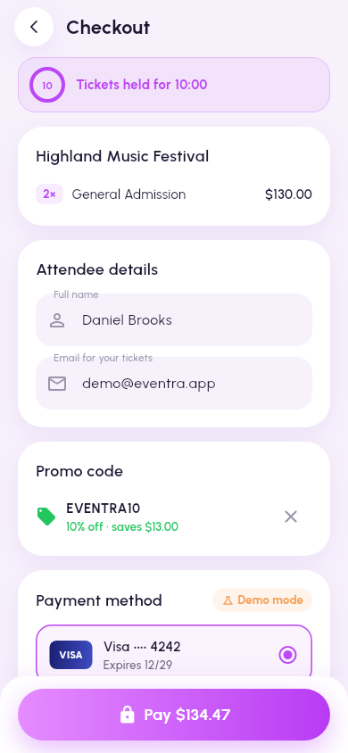
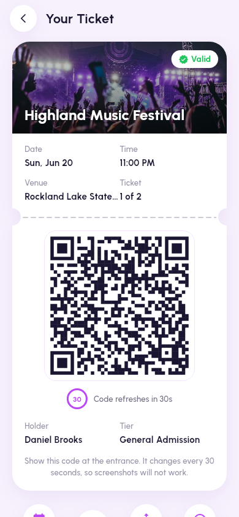

# EVENTRA

**Discover. Book. Feel the moment.**

EVENTRA is an event discovery and ticketing app built with Flutter. The three
core screens (Home, Event Details and the Explore map) are rebuilt from a
Dribbble-style reference design with close visual fidelity: a faceted
lavender gradient header, glassmorphism controls, photo cards with parallax,
a floating gradient nav pill and a full light-gray map with a draggable
"Nearest Location" sheet.

| Home | Event Details | Explore map |
|:---:|:---:|:---:|
|  |  |  |

| Checkout | Ticket (rotating QR) |
|:---:|:---:|
|  |  |

*Screenshots are the golden files rendered by the widget tests (390x844 at
2x, real Urbanist fonts, real photos and offline map tiles), so they always
match the code.*

---

## Features

### Home
- Faceted gradient header with avatar, notification bell (unread dot) and the
  "Discover Amazing Events Near You" headline.
- Glass search pill (opens live search) and a filters button (categories,
  dates, price range, distance, free only, tickets left, sort) with a live
  "Show N results" count.
- Category chips (See All, Cinema, Sports, Social, Music, Art, Tech, Food,
  Comedy) that really filter the feed.
- "Upcoming Events" carousel: centered card full size, neighbours scaled and
  dimmed, parallax photos, location chip, bookmark, avatar stack (+N), date
  and an arrow button. Long titles shrink to fit on one line, as in the
  reference.
- Smart feed: Upcoming is ordered by an on-device, explainable scorer
  (interests, distance from your city or GPS, popularity, how soon, your
  saves); "Because You Like ..." rows follow your interests. Long-press any
  card for a blurred quick preview with reason chips ("Because you like
  Music", "Near you", "Trending"), Save and Share.
- More sections (trending, this weekend, free) with compact cards, "See All"
  list with sorting and filters, pull to refresh.
- Skeleton shimmer while loading, error state with retry, empty state that
  resets filters.
- Favorites tab, notifications screen (mark all read), profile tab.

### Event Details
- Shared-element Hero from any card into a full-bleed photo with parallax on
  scroll and stretch on overscroll; pull down past a threshold to dismiss.
- Glass back and bookmark buttons over the photo; the top bar turns solid and
  shows the event title once the sheet reaches the top.
- Title, date, address, gradient price, participants (tap for the full
  list), "About Event" with an inline **See more....** that expands with an
  animated height change.
- Location mini-map (light-gray basemap, pulsing marker): tap opens the full
  map focused on the event, long-press opens directions in the maps app.
- Organizer card with Follow/Following, lineup timeline, ticket policy,
  rating summary and reviews ("See all" sheet), similar events.
- Bottom bar with Share and an animated **Get a Ticket** button (press squash,
  loading ring, self-drawing check mark, then navigation). Sold-out events
  show a disabled "Sold Out" button and a "Join waitlist" toggle.

### Explore (map)
- Full-screen light-gray map with street labels (no API key, attribution
  shown) with pinch, drag and double-tap zoom.
- White circular back and locate-me buttons; a floating preview card for the
  selected event (tap opens Event Details).
- Pulsing marker (looping ripple) on the selected event and small pins for
  the others; tapping a pin selects it.
- Draggable sheet with three snap points (peek, half, full); the camera keeps
  the selected marker visible above the sheet while it moves.
- "Search Your Location..." filters by event, venue or address; the filter
  icon opens the same Filters sheet as Home.
- "Nearest Location" list sorted by **Haversine** distance (e.g. 3.11KM,
  5.21KM), with a purple selection border and a smooth fly-to camera
  animation (zooms out a little on long hops).
- Locate me asks for permission, shows the blue "you are here" dot and
  re-sorts every distance from the device position; when denied it keeps the
  demo location and says so.
- Continue opens the selected venue's events (straight to details when the
  venue has a single event).

### Search
- Auto-focused field with debounced live results, best title matches first,
  matched text highlighted; the shared filters narrow the results.
- Recent searches saved per account (swipe to delete with undo, Clear all),
  trending search chips, and a no-results state with suggestions.

### Onboarding and accounts
- Splash with the brand logo, a 3-slide onboarding (shown once), then Log in,
  Sign up (live password strength meter), a 6-box email code (resend
  countdown) and Forgot password.
- **Try demo account** on the login screen signs in instantly
  (`demo@eventra.app` / `Eventra#2026`); in debug builds the mock email code
  `123456` is shown on screen.
- Guest mode: browse Home, Explore and Details without an account; Get a
  Ticket asks you to log in and brings you back to the same event.
- Pick at least 3 interests and a home city (or use your location).
- Local auth that behaves like the real thing: PBKDF2-SHA256 salted hashes
  (never plain text), session token in the Keychain/Keystore, 30-day
  sessions, 5 failed logins lock the email for 30 seconds with a countdown.

### Tickets, checkout and wallet
- Tier picker with live availability (other buyers' holds count), quantity
  steppers with per-tier and 8-per-order limits, low-stock and sold-out
  states, and a running total with fees and tax.
- Seats are held for 10 minutes when you continue (countdown banner that
  turns orange, then red); leaving checkout or letting the hold expire gives
  the seats back. Stock changes are atomic, and a database CHECK makes
  overselling impossible.
- Checkout: attendee details prefilled from your account, promo codes
  (`EVENTRA10` 10% off, `WELCOME5` $5 off once per account, `VIP20` 20% off
  VIP; `SUMMER25` is expired and `FLASH50` fully redeemed), a price breakdown
  in integer cents, and simulated card payments (demo mode, nothing is
  charged): saved Visa 4242 and Mastercard 4444 (asks for 3-D Secure), or a
  new card checked with Luhn. `4000 0000 0000 0002` is declined, `4000 0000
  0000 3220` asks for 3-D Secure, `4000 0000 0000 0119` times out. Every
  attempt has an idempotency key, so a double tap never charges twice. Only
  the card brand and last four digits are stored.
- Success page with a ticket that slides in, a perforation that draws itself
  and a one-time holographic shine; Add to Calendar and Invite Friends.
- **My Tickets** tab (Upcoming / Past / Cancelled, swipeable) and a ticket
  page with a signed QR code that rotates every 30 seconds (HMAC-SHA256,
  verifiable offline), brightness at max while it is open, directions,
  calendar, invite, order details and refunds: a full refund when you cancel
  more than 48 hours before the start, none after; stock is restored.
- Local reminders 24 hours and 2 hours before the event (tapping one opens
  the ticket).

### Profile, settings, favorites, notifications, reviews
- Profile with an initials avatar on your color, city, bio and stats
  (tickets, saved, reviews); edit profile with validation.
- Settings: theme mode (System/Light/Dark), language (EN/FR/AR, stored now,
  strings later), notification toggles that really gate reminders and inbox
  items, personalized feed, clear cache, about/version, log out, delete
  account (type DELETE).
- Favorites in a list or grid, sortable, swipe to remove with Undo.
- Notification center stored on the device: welcome items, booking
  confirmations and refunds, unread badge, mark all read, swipe dismiss with
  Undo, tap to open the ticket or event.
- Reviews: only attendees holding a ticket for an event that has ended can
  review (1-5 stars, 10-500 characters, one per event, edit/delete your own).
  Event Details shows the average, count, histogram and latest reviews, with
  a See all screen (star filter, sort). The demo account attends one past
  event, so you can try it.

### Quality
- Respects reduce-motion (looping and entrance animations are skipped).
- Semantics labels on every icon button, card and list row.
- Offline-first demo backend with simulated latency and fault injection.

---

## Architecture

Feature-first clean architecture with Riverpod 3 and go_router.

```
lib/
  app/            app widget, router (StatefulShellRoute, 5 tabs), auth guard, nav pill
  core/
    theme/        design tokens (EventraTokens ThemeExtension), text styles
    widgets/      glass, gradient button, pressable, skeleton, avatar stack, images
    map/          map style + tile layer, pulsing marker, attribution, user dot
    location/     LocationService abstraction (geolocator implementation)
    utils/        formatters, Haversine geo helpers
    result/       Result<T> + typed failures
    crypto/       PBKDF2-HMAC-SHA256 on the crypto package
    storage/      prefs + secure storage abstractions
  features/
    events/       domain entities (freezed), repositories, drift DB, demo backend
    home/         feed sections, filters, chips, carousel, See All
    event_details/ details screen and its sections
    explore/      nearest-events domain, map screen, sheet widgets
    auth/         AuthRepository, local PBKDF2 implementation, login/sign-up/OTP
    onboarding/   splash, slides, interests, location setup
    tickets/      pricing, promo, Luhn, payment gateway, QR signing, refunds,
                  reminders; ticketing repository; picker, checkout, wallet
    profile/      profile repository (profiles table), edit profile, account deletion
    settings/     AppSettings + SettingsController (prefs), settings screen
    notifications/ notifications table + repository, inbox screen
    reviews/      ReviewRules, reviews repository, details section, all-reviews screen
    favorites/ search/ design_system/
```

- **State**: Riverpod `Notifier`/`Provider` (favorites with optimistic
  updates and rollback, filters, query, user location, nearest events).
- **Data**: a 60-event seed (56 upcoming, 4 past) (`assets/seed/events.json`, 8 categories, real
  Unsplash photos, coordinates around New City, NY like the reference map) is
  loaded into a drift SQLite database through `LocalDemoBackend`, which
  simulates latency and failures. Repositories return `Result<T>`.
- **Routing**: event pages are nested under each tab so the Hero flies inside
  the tab navigator and the nav pill hides on pushed pages; deep link
  `https://eventra.app/event/<id>` redirects into the Home tab.
- **Maps**: flutter_map + latlong2. The default `MapStyle` draws
  OpenStreetMap tiles through a grayscale "Positron" color filter, which
  reproduces the reference's light-gray map without an API key (CARTO's
  keyless raster endpoint now serves an "API KEY REQUIRED" watermark;
  `MapStyle.cartoPositron` is ready for builds with a CARTO key). Style and
  tile provider are injected through providers, so tests use bundled tiles.
- **Design system**: every color, radius, shadow and motion value lives in
  `EventraTokens`; there is an in-app Design System screen (Profile).

---

## Getting started

Requirements: Flutter 3.35+ (Dart 3.9+); developed and tested on Flutter 3.47.

```bash
flutter pub get
flutter run                 # Android, iOS or desktop
```

Quality gate (format check, analyze, tests with coverage):

```bash
./tool/check.sh             # add -j 1 on low-memory machines
```

Update the golden screenshots after an intentional UI change:

```bash
flutter test --update-goldens --tags golden
```

Regenerate code (freezed, json_serializable, drift) after model changes:

```bash
dart run build_runner build --delete-conflicting-outputs
```

---

## Testing

Unit tests (Haversine, nearest sorting, filters, Result, seed integrity,
repositories with an in-memory drift DB) and widget tests for every
interaction on the three reference screens: chip filtering, bookmark, carousel
navigation, filters sheet, search, See more, Get a Ticket, follow, Hero
navigation, map selection, search, locate-me (granted and denied), sheet
snapping and Continue, plus the ticketing rules (pricing, promo codes, Luhn,
holds with a fake clock, no oversell under concurrency, idempotency, QR
signing and rotation, refunds) and the full purchase journey. Golden tests
render Home, Event Details, Explore, Checkout and the ticket
with real fonts, photos (test/fixtures/images) and map tiles
(test/fixtures/tiles). See [PROGRESS.md](PROGRESS.md) for exact counts per
phase.

Accessibility tests check six screens at 1.3x text size and the tap-target
and labelled-target guidelines. `tool/check.sh` runs the same gate as CI
(format, gen-l10n drift, analyze, tests with coverage and the threshold in
`tool/coverage_threshold.txt`).

## CI and releases

[](https://github.com/bileldh-ing/eventra/actions/workflows/ci.yml)

GitHub Actions run the quality gate on every push and pull request, build
Android release artifacts (AAB/APK) and an unsigned iOS archive on demand,
and publish a GitHub Release for each `v*` tag. Signing and store uploads
are optional and driven by repository secrets; see
[docs/RELEASE.md](docs/RELEASE.md) and [CHANGELOG.md](CHANGELOG.md).

## Credits

Fonts, photos and map data are credited in [CREDITS.md](CREDITS.md). Map
data and tiles © OpenStreetMap contributors. For production traffic, point
`MapStyle` at a tile provider you have an agreement with (OSM's public tile
servers are for light use only).
