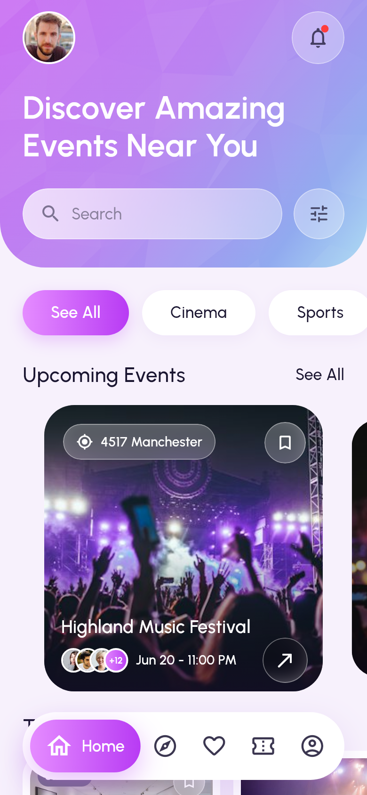
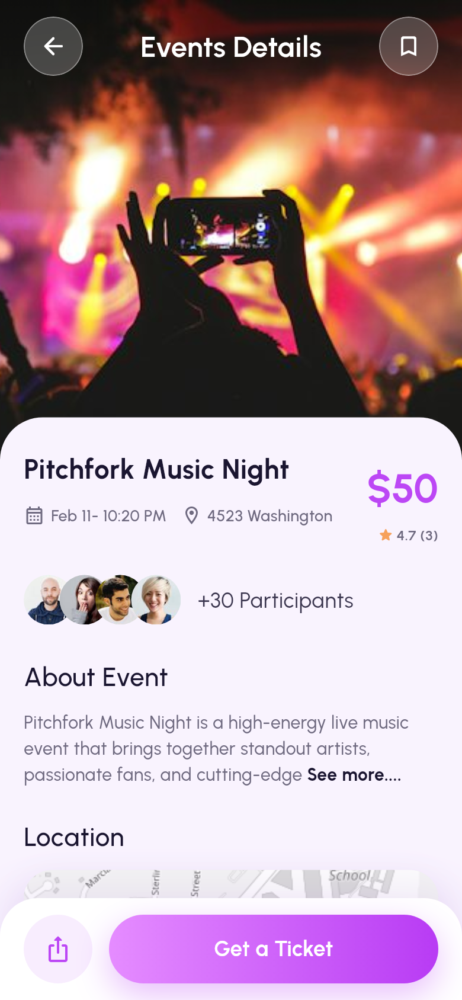
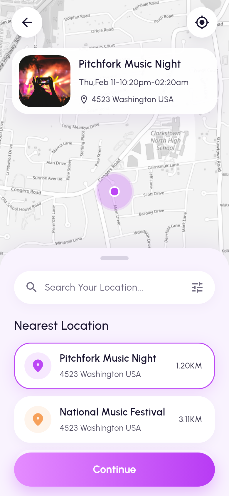

# EVENTRA

**Discover. Book. Feel the moment.**

EVENTRA is an event discovery and ticketing app built with Flutter. The three
core screens (Home, Event Details and the Explore map) are rebuilt from a
Dribbble-style reference design with close visual fidelity: a faceted
lavender gradient header, glassmorphism controls, photo cards with parallax,
a floating gradient nav pill and a full light-gray map with a draggable
"Nearest Location" sheet.

| Home | Event Details | Explore map |
|:---:|:---:|:---:|
|  |  |  |

*Screenshots are the golden files rendered by the widget tests (390x844 at
2x, real Urbanist fonts, real photos and offline map tiles), so they always
match the code.*

---

## Features

### Home
- Faceted gradient header with avatar, notification bell (unread dot) and the
  "Discover Amazing Events Near You" headline.
- Glass search pill (opens live search) and a filters button (categories,
  dates, price range, distance, free only, tickets left, sort) with a live
  "Show N results" count.
- Category chips (See All, Cinema, Sports, Social, Music, Art, Tech, Food,
  Comedy) that really filter the feed.
- "Upcoming Events" carousel: centered card full size, neighbours scaled and
  dimmed, parallax photos, location chip, bookmark, avatar stack (+N), date
  and an arrow button. Long titles shrink to fit on one line, as in the
  reference.
- Smart feed: Upcoming is ordered by an on-device, explainable scorer
  (interests, distance from your city or GPS, popularity, how soon, your
  saves); "Because You Like ..." rows follow your interests. Long-press any
  card for a blurred quick preview with reason chips ("Because you like
  Music", "Near you", "Trending"), Save and Share.
- More sections (trending, this weekend, free) with compact cards, "See All"
  list with sorting and filters, pull to refresh.
- Skeleton shimmer while loading, error state with retry, empty state that
  resets filters.
- Favorites tab, notifications screen (mark all read), profile tab.

### Event Details
- Shared-element Hero from any card into a full-bleed photo with parallax on
  scroll and stretch on overscroll; pull down past a threshold to dismiss.
- Glass back and bookmark buttons over the photo; the top bar turns solid and
  shows the event title once the sheet reaches the top.
- Title, date, address, gradient price, participants (tap for the full
  list), "About Event" with an inline **See more....** that expands with an
  animated height change.
- Location mini-map (light-gray basemap, pulsing marker): tap opens the full
  map focused on the event, long-press opens directions in the maps app.
- Organizer card with Follow/Following, lineup timeline, ticket policy,
  rating summary and reviews ("See all" sheet), similar events.
- Bottom bar with Share and an animated **Get a Ticket** button (press squash,
  loading ring, self-drawing check mark, then navigation). Sold-out events
  show a disabled "Sold Out" button and a "Join waitlist" toggle.

### Explore (map)
- Full-screen light-gray map with street labels (no API key, attribution
  shown) with pinch, drag and double-tap zoom.
- White circular back and locate-me buttons; a floating preview card for the
  selected event (tap opens Event Details).
- Pulsing marker (looping ripple) on the selected event and small pins for
  the others; tapping a pin selects it.
- Draggable sheet with three snap points (peek, half, full); the camera keeps
  the selected marker visible above the sheet while it moves.
- "Search Your Location..." filters by event, venue or address; the filter
  icon opens the same Filters sheet as Home.
- "Nearest Location" list sorted by **Haversine** distance (e.g. 3.11KM,
  5.21KM), with a purple selection border and a smooth fly-to camera
  animation (zooms out a little on long hops).
- Locate me asks for permission, shows the blue "you are here" dot and
  re-sorts every distance from the device position; when denied it keeps the
  demo location and says so.
- Continue opens the selected venue's events (straight to details when the
  venue has a single event).

### Search
- Auto-focused field with debounced live results, best title matches first,
  matched text highlighted; the shared filters narrow the results.
- Recent searches saved per account (swipe to delete with undo, Clear all),
  trending search chips, and a no-results state with suggestions.

### Onboarding and accounts
- Splash with the brand logo, a 3-slide onboarding (shown once), then Log in,
  Sign up (live password strength meter), a 6-box email code (resend
  countdown) and Forgot password.
- **Try demo account** on the login screen signs in instantly
  (`demo@eventra.app` / `Eventra#2026`); in debug builds the mock email code
  `123456` is shown on screen.
- Guest mode: browse Home, Explore and Details without an account; Get a
  Ticket asks you to log in and brings you back to the same event.
- Pick at least 3 interests and a home city (or use your location).
- Local auth that behaves like the real thing: PBKDF2-SHA256 salted hashes
  (never plain text), session token in the Keychain/Keystore, 30-day
  sessions, 5 failed logins lock the email for 30 seconds with a countdown.

### Quality
- Respects reduce-motion (looping and entrance animations are skipped).
- Semantics labels on every icon button, card and list row.
- Offline-first demo backend with simulated latency and fault injection.

---

## Architecture

Feature-first clean architecture with Riverpod 3 and go_router.

```
lib/
  app/            app widget, router (StatefulShellRoute, 4 tabs), auth guard, nav pill
  core/
    theme/        design tokens (EventraTokens ThemeExtension), text styles
    widgets/      glass, gradient button, pressable, skeleton, avatar stack, images
    map/          map style + tile layer, pulsing marker, attribution, user dot
    location/     LocationService abstraction (geolocator implementation)
    utils/        formatters, Haversine geo helpers
    result/       Result<T> + typed failures
    crypto/       PBKDF2-HMAC-SHA256 on the crypto package
    storage/      prefs + secure storage abstractions
  features/
    events/       domain entities (freezed), repositories, drift DB, demo backend
    home/         feed sections, filters, chips, carousel, See All
    event_details/ details screen and its sections
    explore/      nearest-events domain, map screen, sheet widgets
    auth/         AuthRepository, local PBKDF2 implementation, login/sign-up/OTP
    onboarding/   splash, slides, interests, location setup
    favorites/ notifications/ profile/ search/ tickets/ design_system/
```

- **State**: Riverpod `Notifier`/`Provider` (favorites with optimistic
  updates and rollback, filters, query, user location, nearest events).
- **Data**: a 56-event seed (`assets/seed/events.json`, 8 categories, real
  Unsplash photos, coordinates around New City, NY like the reference map) is
  loaded into a drift SQLite database through `LocalDemoBackend`, which
  simulates latency and failures. Repositories return `Result<T>`.
- **Routing**: event pages are nested under each tab so the Hero flies inside
  the tab navigator and the nav pill hides on pushed pages; deep link
  `https://eventra.app/event/<id>` redirects into the Home tab.
- **Maps**: flutter_map + latlong2. The default `MapStyle` draws
  OpenStreetMap tiles through a grayscale "Positron" color filter, which
  reproduces the reference's light-gray map without an API key (CARTO's
  keyless raster endpoint now serves an "API KEY REQUIRED" watermark;
  `MapStyle.cartoPositron` is ready for builds with a CARTO key). Style and
  tile provider are injected through providers, so tests use bundled tiles.
- **Design system**: every color, radius, shadow and motion value lives in
  `EventraTokens`; there is an in-app Design System screen (Profile).

---

## Getting started

Requirements: Flutter 3.35+ (Dart 3.9+); developed and tested on Flutter 3.47.

```bash
flutter pub get
flutter run                 # Android, iOS or desktop
```

Quality gate (format check, analyze, tests with coverage):

```bash
./tool/check.sh             # add -j 1 on low-memory machines
```

Update the golden screenshots after an intentional UI change:

```bash
flutter test --update-goldens --tags golden
```

Regenerate code (freezed, json_serializable, drift) after model changes:

```bash
dart run build_runner build --delete-conflicting-outputs
```

---

## Testing

Unit tests (Haversine, nearest sorting, filters, Result, seed integrity,
repositories with an in-memory drift DB) and widget tests for every
interaction on the three reference screens: chip filtering, bookmark, carousel
navigation, filters sheet, search, See more, Get a Ticket, follow, Hero
navigation, map selection, search, locate-me (granted and denied), sheet
snapping and Continue. Golden tests render Home, Event Details and Explore
with real fonts, photos (test/fixtures/images) and map tiles
(test/fixtures/tiles). See [PROGRESS.md](PROGRESS.md) for exact counts per
phase.

## Credits

Fonts, photos and map data are credited in [CREDITS.md](CREDITS.md). Map
data and tiles © OpenStreetMap contributors. For production traffic, point
`MapStyle` at a tile provider you have an agreement with (OSM's public tile
servers are for light use only).
