<div align="center">

# EVENTRA

**Discover. Book. Go.**

An event discovery and ticketing app built with Flutter: a smart feed, a live
map, a full booking flow with signed QR tickets, reviews, an organizer mode
with offline check-in, three languages (EN / FR / AR with full RTL), light and
dark themes, and CI/CD for Android and iOS.

[](https://github.com/bileldh-ing/eventra/actions/workflows/ci.yml)
[](https://github.com/bileldh-ing/eventra/actions/workflows/android-release.yml)
[](https://github.com/bileldh-ing/eventra/actions/workflows/ios-build.yml)


**Demo video:** __VIDEO_LINKS__

</div>

> Every screen on this page is the real app, rendered by Flutter widget tests
> (`test/screenshots/`) with the production widgets, seed data, bundled fonts
> and offline map tiles. They are not mockups, and they are not captured from
> a physical device (see [Limitations](#honest-limitations)).

---

## Screens

| Onboarding | Login | Home | Home (dark) | Home (Arabic, RTL) |
|:---:|:---:|:---:|:---:|:---:|
|  | 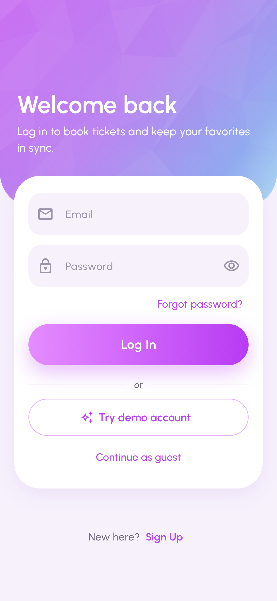 |  | 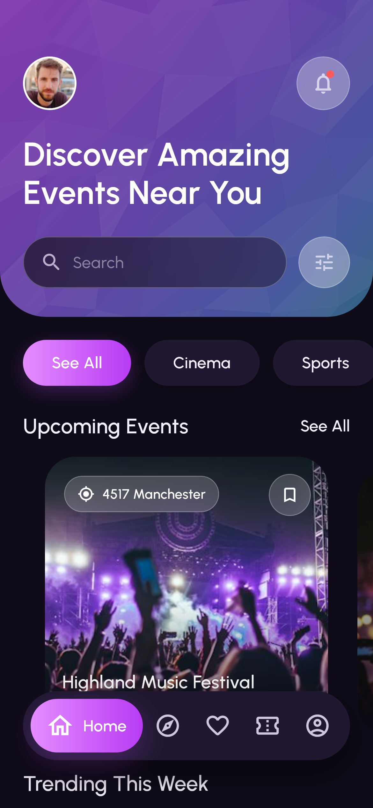 | 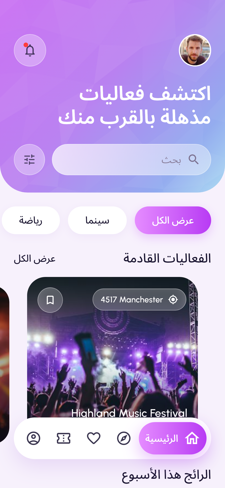 |
| **Explore map** | **Search** | **Filters** | **Event details** | **Reviews** |
| 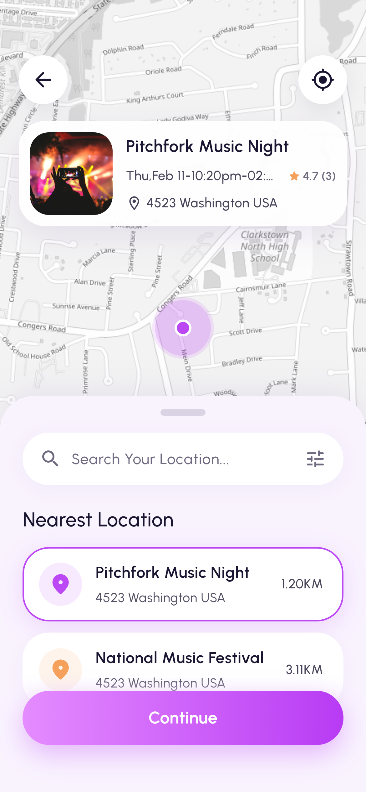 | 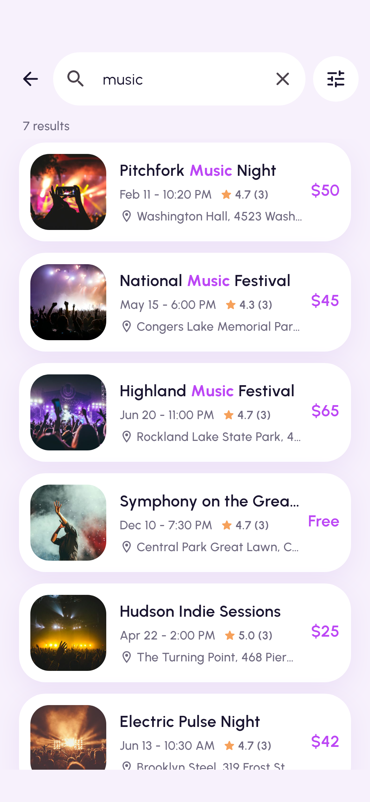 | 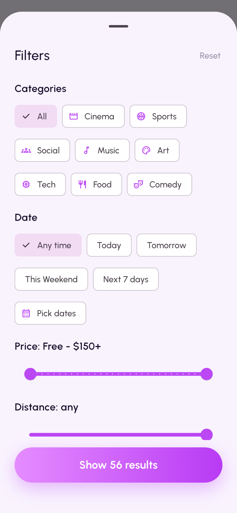 | 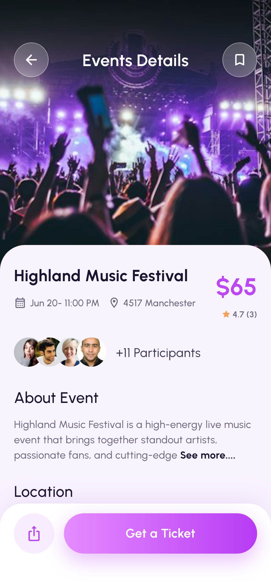 | 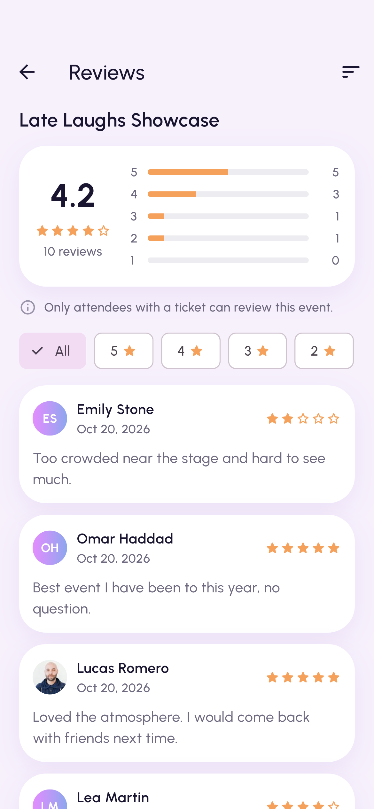 |
| **Ticket picker** | **Checkout** | **Booked** | **Ticket QR** | **Favorites** |
| 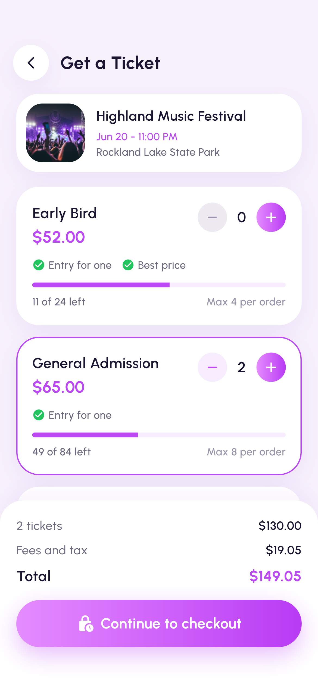 | 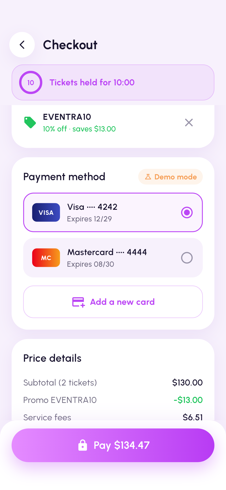 | 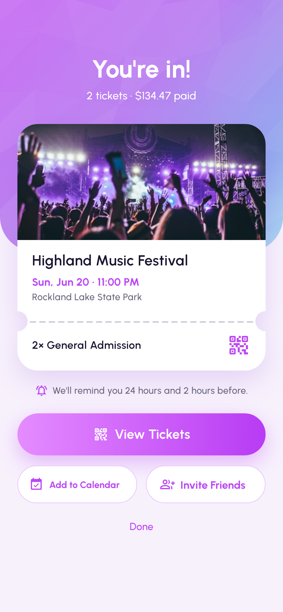 | 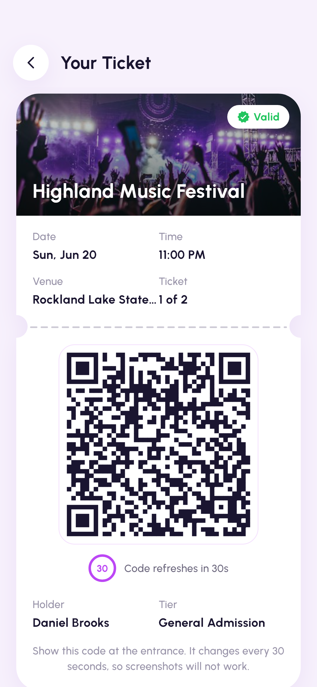 | 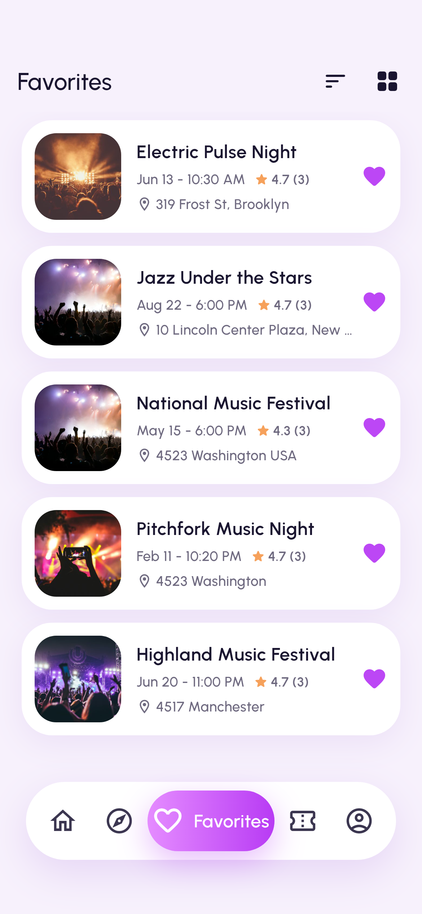 |
| **Notifications** | **Profile** | **Settings** | **Organizer dashboard** | **Event wizard** |
| 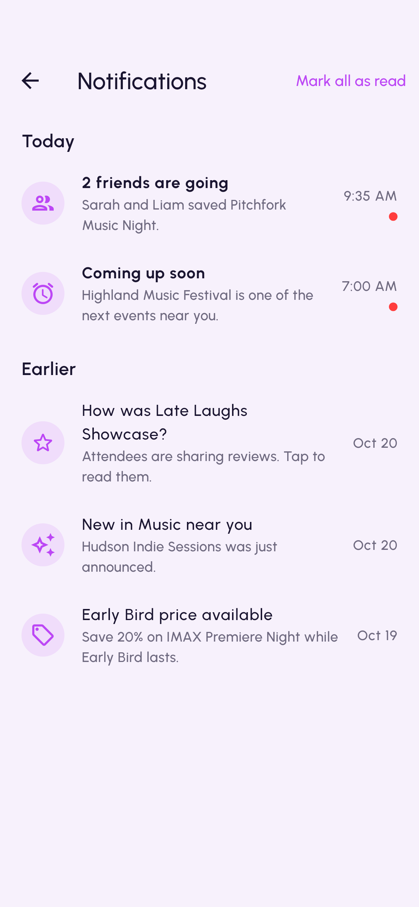 | 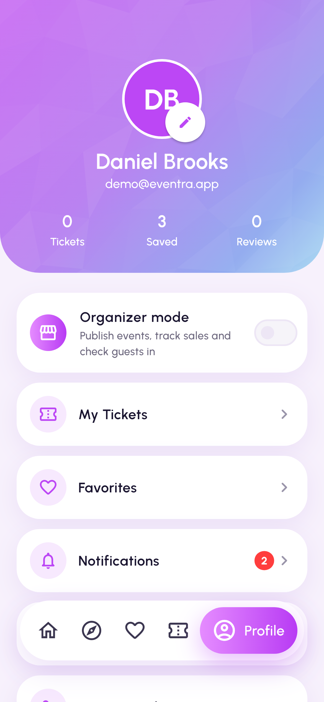 | 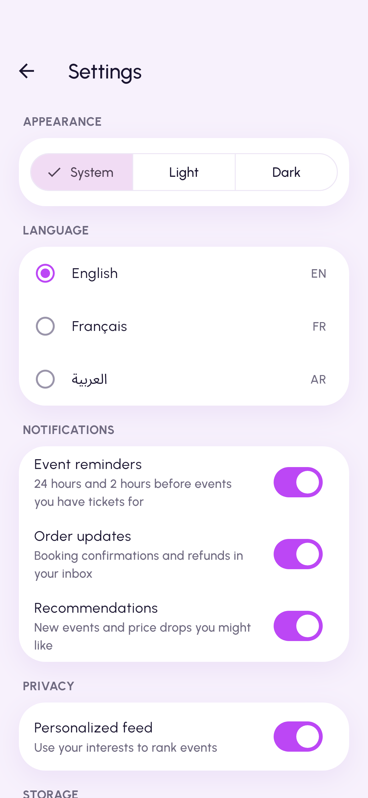 | 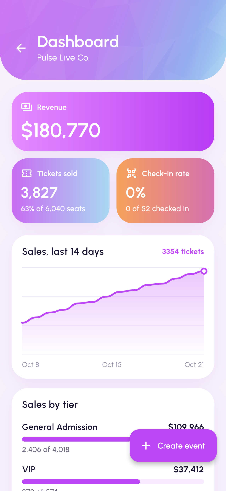 | 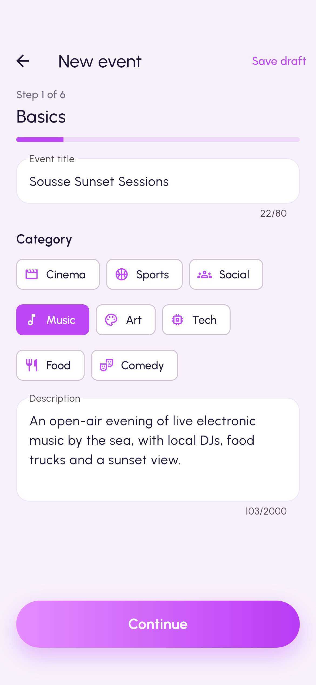 |
| **Check-in result** | | | | |
| 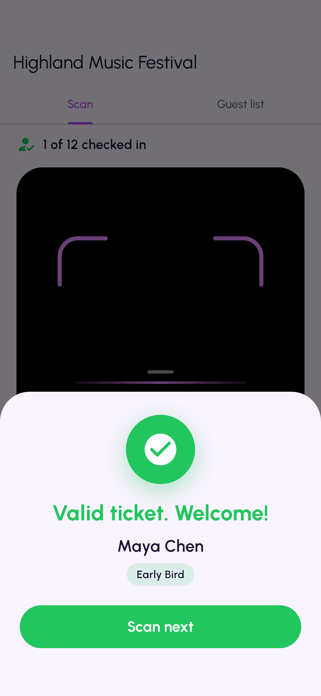 | | | | |

---

## Highlights

- **Discover**: a smart feed ranked on the device by an explainable scorer
  (interests, distance, popularity, how soon, your saves), category chips,
  debounced live search with highlighted matches, and one filters sheet
  (category, date, price, distance, free, tickets left, sort).
- **Map**: OpenStreetMap through flutter_map, pulsing selected marker, a
  three-stop draggable "Nearest Location" sheet sorted by Haversine distance,
  locate-me with a permission-denied fallback.
- **Book & Pay**: tier picker with live stock, 10-minute seat holds, promo
  codes, integer-cent pricing, a mock card gateway with 3-D Secure, declines
  and timeouts, idempotent payments and a database CHECK that makes
  overselling impossible.
- **Wallet**: tickets with an HMAC-SHA256 signed QR that rotates every 30
  seconds and verifies offline; refunds (full refund more than 48 h before the
  start), reminders 24 h and 2 h before, add to calendar.
- **Reviews**: only ticket holders of an ended event can review; average,
  histogram, sort and star filters.
- **Organizer mode**: dashboard (revenue, sales, check-in rate, 14-day chart),
  a 6-step create/edit wizard with draft autosave, camera or typed QR check-in
  that is exactly-once and queues offline for sync.
- **Everywhere**: English, French and Arabic (666 keys, full RTL), light and
  dark palettes (WCAG AA checked by test), 48 dp tap targets, semantics
  labels, layouts that hold at 1.3x text, reduce-motion support.

<details>
<summary><b>Full feature list</b></summary>

#### Home
- Faceted gradient header with avatar, notification bell (unread dot) and the
  "Discover Amazing Events Near You" headline.
- Glass search pill (opens live search) and a filters button (categories,
  dates, price range, distance, free only, tickets left, sort) with a live
  "Show N results" count.
- Category chips (See All, Cinema, Sports, Social, Music, Art, Tech, Food,
  Comedy) that really filter the feed.
- "Upcoming Events" carousel: centered card full size, neighbours scaled and
  dimmed, parallax photos, location chip, bookmark, avatar stack (+N), date
  and an arrow button. Long titles shrink to fit on one line, as in the
  reference.
- Smart feed: Upcoming is ordered by an on-device, explainable scorer
  (interests, distance from your city or GPS, popularity, how soon, your
  saves); "Because You Like ..." rows follow your interests. Long-press any
  card for a blurred quick preview with reason chips ("Because you like
  Music", "Near you", "Trending"), Save and Share.
- More sections (trending, this weekend, free) with compact cards, "See All"
  list with sorting and filters, pull to refresh.
- Skeleton shimmer while loading, error state with retry, empty state that
  resets filters.
- Favorites tab, notifications screen (mark all read), profile tab.

#### Event Details
- Shared-element Hero from any card into a full-bleed photo with parallax on
  scroll and stretch on overscroll; pull down past a threshold to dismiss.
- Glass back and bookmark buttons over the photo; the top bar turns solid and
  shows the event title once the sheet reaches the top.
- Title, date, address, gradient price, participants (tap for the full
  list), "About Event" with an inline **See more....** that expands with an
  animated height change.
- Location mini-map (light-gray basemap, pulsing marker): tap opens the full
  map focused on the event, long-press opens directions in the maps app.
- Organizer card with Follow/Following, lineup timeline, ticket policy,
  rating summary and reviews ("See all" sheet), similar events.
- Bottom bar with Share and an animated **Get a Ticket** button (press squash,
  loading ring, self-drawing check mark, then navigation). Sold-out events
  show a disabled "Sold Out" button and a "Join waitlist" toggle.

#### Explore (map)
- Full-screen light-gray map with street labels (no API key, attribution
  shown) with pinch, drag and double-tap zoom.
- White circular back and locate-me buttons; a floating preview card for the
  selected event (tap opens Event Details).
- Pulsing marker (looping ripple) on the selected event and small pins for
  the others; tapping a pin selects it.
- Draggable sheet with three snap points (peek, half, full); the camera keeps
  the selected marker visible above the sheet while it moves.
- "Search Your Location..." filters by event, venue or address; the filter
  icon opens the same Filters sheet as Home.
- "Nearest Location" list sorted by **Haversine** distance (e.g. 3.11KM,
  5.21KM), with a purple selection border and a smooth fly-to camera
  animation (zooms out a little on long hops).
- Locate me asks for permission, shows the blue "you are here" dot and
  re-sorts every distance from the device position; when denied it keeps the
  demo location and says so.
- Continue opens the selected venue's events (straight to details when the
  venue has a single event).

#### Search
- Auto-focused field with debounced live results, best title matches first,
  matched text highlighted; the shared filters narrow the results.
- Recent searches saved per account (swipe to delete with undo, Clear all),
  trending search chips, and a no-results state with suggestions.

#### Onboarding and accounts
- Splash with the brand logo, a 3-slide onboarding (shown once), then Log in,
  Sign up (live password strength meter), a 6-box email code (resend
  countdown) and Forgot password.
- **Try demo account** on the login screen signs in instantly
  (`demo@eventra.app` / `Eventra#2026`); in debug builds the mock email code
  `123456` is shown on screen.
- Guest mode: browse Home, Explore and Details without an account; Get a
  Ticket asks you to log in and brings you back to the same event.
- Pick at least 3 interests and a home city (or use your location).
- Local auth that behaves like the real thing: PBKDF2-SHA256 salted hashes
  (never plain text), session token in the Keychain/Keystore, 30-day
  sessions, 5 failed logins lock the email for 30 seconds with a countdown.

#### Tickets, checkout and wallet
- Tier picker with live availability (other buyers' holds count), quantity
  steppers with per-tier and 8-per-order limits, low-stock and sold-out
  states, and a running total with fees and tax.
- Seats are held for 10 minutes when you continue (countdown banner that
  turns orange, then red); leaving checkout or letting the hold expire gives
  the seats back. Stock changes are atomic, and a database CHECK makes
  overselling impossible.
- Checkout: attendee details prefilled from your account, promo codes
  (`EVENTRA10` 10% off, `WELCOME5` $5 off once per account, `VIP20` 20% off
  VIP; `SUMMER25` is expired and `FLASH50` fully redeemed), a price breakdown
  in integer cents, and simulated card payments (demo mode, nothing is
  charged): saved Visa 4242 and Mastercard 4444 (asks for 3-D Secure), or a
  new card checked with Luhn. `4000 0000 0000 0002` is declined, `4000 0000
  0000 3220` asks for 3-D Secure, `4000 0000 0000 0119` times out. Every
  attempt has an idempotency key, so a double tap never charges twice. Only
  the card brand and last four digits are stored.
- Success page with a ticket that slides in, a perforation that draws itself
  and a one-time holographic shine; Add to Calendar and Invite Friends.
- **My Tickets** tab (Upcoming / Past / Cancelled, swipeable) and a ticket
  page with a signed QR code that rotates every 30 seconds (HMAC-SHA256,
  verifiable offline), brightness at max while it is open, directions,
  calendar, invite, order details and refunds: a full refund when you cancel
  more than 48 hours before the start, none after; stock is restored.
- Local reminders 24 hours and 2 hours before the event (tapping one opens
  the ticket).

#### Profile, settings, favorites, notifications, reviews
- Profile with an initials avatar on your color, city, bio and stats
  (tickets, saved, reviews); edit profile with validation.
- Settings: theme mode (System/Light/Dark), language (EN/FR/AR,
  switched at runtime), notification toggles that really gate reminders and inbox
  items, personalized feed, clear cache, about/version, log out, delete
  account (type DELETE).
- Favorites in a list or grid, sortable, swipe to remove with Undo.
- Notification center stored on the device: welcome items, booking
  confirmations and refunds, unread badge, mark all read, swipe dismiss with
  Undo, tap to open the ticket or event.
- Reviews: only attendees holding a ticket for an event that has ended can
  review (1-5 stars, 10-500 characters, one per event, edit/delete your own).
  Event Details shows the average, count, histogram and latest reviews, with
  a See all screen (star filter, sort). The demo account attends one past
  event, so you can try it.

#### Quality
- Respects reduce-motion (looping and entrance animations are skipped).
- Semantics labels on every icon button, card and list row.
- Offline-first demo backend with simulated latency and fault injection.

</details>

---

## Architecture

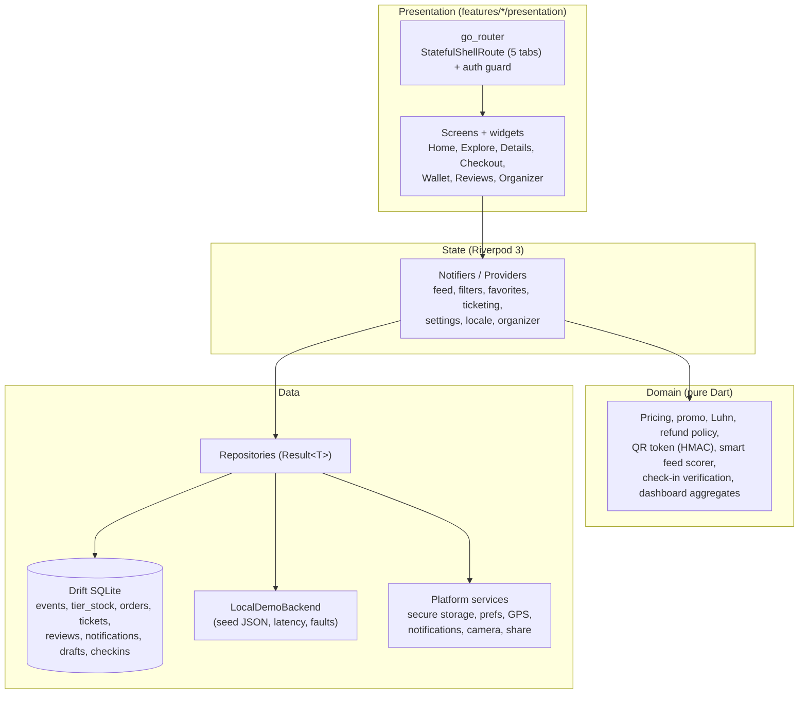

<details>
<summary><b>Folder layout and data notes</b></summary>

Feature-first clean architecture with Riverpod 3 and go_router.

```
lib/
  app/            app widget, router (StatefulShellRoute, 5 tabs), auth guard, nav pill
  core/
    theme/        design tokens (EventraTokens ThemeExtension), text styles
    widgets/      glass, gradient button, pressable, skeleton, avatar stack, images
    map/          map style + tile layer, pulsing marker, attribution, user dot
    location/     LocationService abstraction (geolocator implementation)
    utils/        formatters, Haversine geo helpers
    result/       Result<T> + typed failures
    crypto/       PBKDF2-HMAC-SHA256 on the crypto package
    storage/      prefs + secure storage abstractions
  features/
    events/       domain entities (freezed), repositories, drift DB, demo backend
    home/         feed sections, filters, chips, carousel, See All
    event_details/ details screen and its sections
    explore/      nearest-events domain, map screen, sheet widgets
    auth/         AuthRepository, local PBKDF2 implementation, login/sign-up/OTP
    onboarding/   splash, slides, interests, location setup
    tickets/      pricing, promo, Luhn, payment gateway, QR signing, refunds,
                  reminders; ticketing repository; picker, checkout, wallet
    profile/      profile repository (profiles table), edit profile, account deletion
    settings/     AppSettings + SettingsController (prefs), settings screen
    notifications/ notifications table + repository, inbox screen
    reviews/      ReviewRules, reviews repository, details section, all-reviews screen
    favorites/ search/ design_system/
```

- **State**: Riverpod `Notifier`/`Provider` (favorites with optimistic
  updates and rollback, filters, query, user location, nearest events).
- **Data**: a 60-event seed (56 upcoming, 4 past) (`assets/seed/events.json`, 8 categories, real
  Unsplash photos, coordinates around New City, NY like the reference map) is
  loaded into a drift SQLite database through `LocalDemoBackend`, which
  simulates latency and failures. Repositories return `Result<T>`.
- **Routing**: event pages are nested under each tab so the Hero flies inside
  the tab navigator and the nav pill hides on pushed pages; deep link
  `https://eventra.app/event/<id>` redirects into the Home tab.
- **Maps**: flutter_map + latlong2. The default `MapStyle` draws
  OpenStreetMap tiles through a grayscale "Positron" color filter, which
  reproduces the reference's light-gray map without an API key (CARTO's
  keyless raster endpoint now serves an "API KEY REQUIRED" watermark;
  `MapStyle.cartoPositron` is ready for builds with a CARTO key). Style and
  tile provider are injected through providers, so tests use bundled tiles.
- **Design system**: every color, radius, shadow and motion value lives in
  `EventraTokens`; there is an in-app Design System screen (Profile).

</details>

## Tech stack

| Area | Choice |
|---|---|
| UI | Flutter 3.47 (Dart 3.9+), Material 3, custom design tokens (`EventraTokens`), Urbanist + Noto Sans Arabic |
| State | Riverpod 3 (`flutter_riverpod`) |
| Navigation | go_router 16 (StatefulShellRoute, guards, deep links) |
| Data | Drift (SQLite) with raw-SQL extras, freezed + json_serializable models |
| Maps and location | flutter_map 8 + latlong2 (OpenStreetMap), geolocator |
| Tickets | qr_flutter, crypto (HMAC-SHA256, PBKDF2), mobile_scanner, screen_brightness |
| Device | flutter_local_notifications, flutter_secure_storage, share_plus, url_launcher |
| i18n | flutter gen-l10n, ARB files for EN / FR / AR, intl formatting |
| Quality | very_good_analysis, mocktail, golden + accessibility tests, lcov coverage gate |
| CI/CD | GitHub Actions (CI, Android release, iOS build, tag release), Fastlane skeleton |

---

## Getting started

Requirements: Flutter 3.47.x (Dart 3.9+).

```bash
flutter pub get
flutter run                     # Android, iOS or desktop
```

Demo account: tap **Try demo account** on the login screen
(`demo@eventra.app` / `Eventra#2026`). In debug builds the mock email code
`123456` is shown on screen. Payments: the saved Visa ····4242 pays;
as a new card,
`4000 0000 0000 0002` is declined, `4000 0000 0000 3220` asks for 3-D Secure.

### Test

```bash
./tool/check.sh                 # format, gen-l10n drift, analyze, tests + coverage threshold
flutter test -j 1               # low-memory machines: one file at a time
flutter test --update-goldens --tags golden   # after an intentional UI change
```

### Screenshots and demo video

```bash
flutter test --tags screenshots test/screenshots -j 1   # writes docs/screenshots/*.png (1170x2532)
```

The screenshot test is tagged `screenshots` and excluded from CI. The demo
video is assembled from those PNGs with ImageMagick (device frame) and ffmpeg
(title cards, xfade transitions, captions, a locally synthesized ambient pad).

### Release

- `android-release.yml`: AAB + APK, signed with the upload key from
  repository secrets (falls back to the debug key when they are absent).
- `ios-build.yml`: unsigned `flutter build ipa --no-codesign`; the signed IPA
  and TestFlight path runs only when signing secrets exist.
- `release.yml`: pushing a `v*` tag builds both and publishes a GitHub
  Release with the CHANGELOG section.

Details: [docs/RELEASE.md](docs/RELEASE.md), [CHANGELOG.md](CHANGELOG.md).

---

## Quality in numbers

| Metric | Value |
|---|---|
| Tests on CI (goldens excluded) | 352 passing, 0 failing |
| Line coverage (generated code excluded) | 91.50 % (threshold 89.5 %) |
| Hand-written Dart in `lib/` | 147 files, ~27.3k lines |
| Test files | 49 (~7.2k lines) |
| Localized strings | 666 keys x 3 languages |
| Seed catalogue | 60 events (56 upcoming, 4 past), 8 categories |

Case study: [docs/CASE_STUDY.md](docs/CASE_STUDY.md). Phase-by-phase log with
exact gates: [PROGRESS.md](PROGRESS.md).

---

## Honest limitations

- **No real-device test by the author.** Everything was built and verified
  in a headless Linux sandbox: widget, golden and accessibility tests, and
  CI builds of the Android APK/AAB and an unsigned iOS archive. GPS
  prompts, camera scanning, the share sheet, notifications and haptics are
  covered through abstractions, not on hardware.
- **Payments are mocked.** The gateway simulates cards, 3-D Secure, declines
  and timeouts; nothing is charged and no payment provider is integrated.
- **Local demo backend.** Accounts, orders and tickets live on the device
  (drift + secure storage); the check-in sync endpoint is a local demo, and
  a real scanner fleet would need per-event QR keys from a server.
- **Map tiles.** The app uses OpenStreetMap's public tile servers, which are
  for light use only; production needs a tile provider agreement (a CARTO
  style is ready behind a key).
- **Not built:** biometric login, Google / Apple sign-in, voice search, a
  friends graph ("friends going"), ticket transfer, Apple / Google Pay,
  image upload for organizer covers. No store upload has been run.
- Seed event content is in English in every language.

## Credits

Fonts, photos and map data are credited in [CREDITS.md](CREDITS.md). Map
data and tiles © OpenStreetMap contributors.
